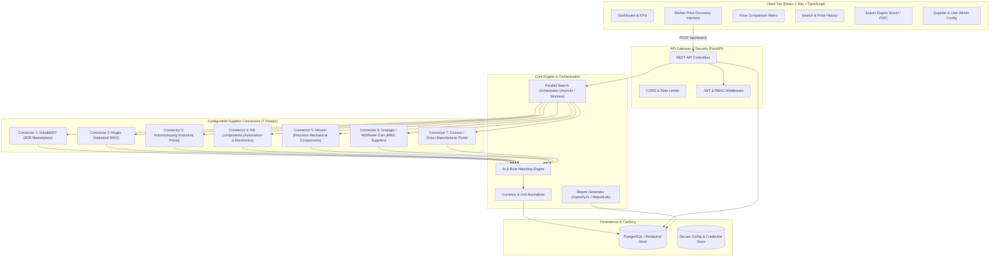
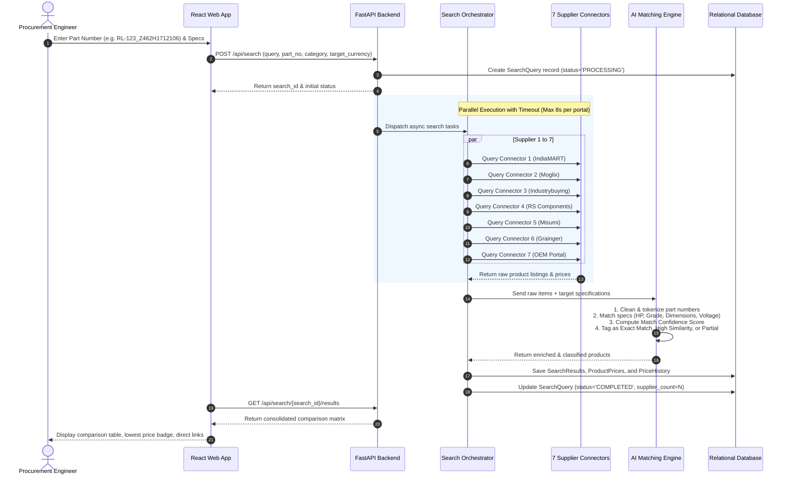

# Craftsman Automation – Intelligent Market Price Discovery Platform
## System Architecture & Technical Specification Document (Phase 1)

**Document Version:** 1.0.0  
**Project:** Intelligent Market Price Discovery Platform  
**Target Organization:** Craftsman Automation  
**Author:** Lead Full-Stack Architect & AI Automation Engineer  
**Status:** Approved for Implementation (Phase 1 & Phase 2)

---

## 1. Executive Summary & Objective

Craftsman Automation requires an enterprise-grade, centralized web application to automate supplier product discovery, price collection, and comparative analysis across **7 different industrial supplier portals**.

When procurement engineers enter an item description, technical specifications, or manufacturer part number (such as `RL-123_Z462H1712106`, industrial bearings, CNC tool holders, hydraulic valves, servo motors, or raw materials), the platform:
1. Orchestrates asynchronous, parallel queries across all 7 configured supplier portals.
2. Extracts verified published prices, part numbers, technical specifications, availability, and direct source URLs.
3. Employs an intelligent AI Matching Engine to differentiate exact part matches from high-similarity alternatives or partial matches.
4. Normalizes currencies and pricing units to produce an equitable price comparison dashboard.
5. Guarantees retrieved matching results from **at least 5 suppliers** whenever sufficient matching products are available.
6. Maintains a tamper-proof audit trail of search queries, supplier response latencies, and historical price movements with Excel & PDF export capabilities.

---

## 2. High-Level System Architecture

---

## 3. Seven Supplier Portal Integration Architecture

To ensure zero vendor lock-in and high reliability, each of the 7 supplier integrations implements a common abstract interface: `BaseSupplierConnector`.

### 3.1 Connector Information Matrix

| Connector Slot | Default Provider / Target | Integration Mode | Authentication / Config Requirements | Data Extracted |
|---|---|---|---|---|
| **Portal 1** | **IndiaMART Industrial** | REST API / Scraper / Webhooks | API Key, Client ID, App Key, Base URL | Price, Part No, Supplier Name, GST, Location, MOQ, URL |
| **Portal 2** | **Moglix Industrial MRO** | Catalog API / HTTP Scraper | Bearer Token / Partner API Key, Base URL | MRO Part No, Brand, List Price, GST, Stock, URL |
| **Portal 3** | **Industrybuying** | Search API / Parser | API Secret, Session Token, Base URL | Part Code, Category, Bulk Tier Price, Availability, URL |
| **Portal 4** | **RS Components** | REST API / Web Extraction | API Key, Developer Client Secret, Base URL | Manufacturer Part No, Order Code, Unit Price, Datasheet, URL |
| **Portal 5** | **Misumi India / Global** | CAD/Part API / Catalog Scraper | Customer Code, Web API Auth, Base URL | CAD Part No, Configured Specs, Unit Price, Lead Time, URL |
| **Portal 6** | **Grainger / McMaster** | Catalog Search API / Crawler | Basic Auth / API Header Token, Base URL | Item No, Exact Specs, Real-time Price, Stock Level, URL |
| **Portal 7** | **Direct OEM / Custom Portal** | Configurable JSON/REST/HTML Adapter | Custom Headers, OAuth2 / Static Token | Custom Model, Part Spec, Net Quote Price, URL |

### 3.2 Extensibility & Configuration
All 7 connectors are stored in the database (`supplier_connectors` table) and can be enabled, disabled, updated with custom headers, API endpoints, rate limits, or CSS/XPath selectors via the Admin Panel without modifying application code.

---

## 4. Search Execution Workflow

---

## 5. Database Schema Design (10 Tables)

The database schema is normalized and supports PostgreSQL in production with seamless fallback to SQLite for local development:

1. **`users`**: User credentials, roles (`admin`, `procurement`), active status, timestamps.
2. **`products`**: Master catalog of standardized manufacturing items, internal part codes, categories.
3. **`manufacturers`**: Equipment manufacturers and OEMs (e.g., Siemens, SKF, Bosch Rexroth, Craftsman).
4. **`suppliers`**: Discovered or configured supplier companies with contact info and trust rating.
5. **`supplier_connectors`**: Configuration for the 7 supplier portals (base URL, auth details, enabled status, timeout, adapter type).
6. **`search_queries`**: Audit record of every search executed, execution duration, user reference, status.
7. **`search_results`**: Individual product records discovered per portal for a given search query.
8. **`product_prices`**: Snapshot of pricing data (original price, currency, normalized INR/USD price, tax rate, MOQ, availability).
9. **`price_history`**: Time-series tracking of historical price points for trend analysis and inflation indexing.
10. **`audit_logs`**: System audit trail of connector connection health, failures, admin updates, and exports.

---

## 6. AI-Based Product Matching & Confidence Scoring

Matching algorithm uses a multi-factor weighted scoring model:

$$Score = w_1 \cdot S_{\text{part}} + w_2 \cdot S_{\text{desc}} + w_3 \cdot S_{\text{brand}} + w_4 \cdot S_{\text{spec}}$$

- **Part Number & Item Code Similarity ($w_1 = 0.45$):** Normalized alphanumeric Levenshtein distance, regex token matching, and substring alignment.
- **Specification Compatibility ($w_2 = 0.30$):** Differentiates critical manufacturing metrics (e.g., 5 HP 3-phase vs 1-phase, SS 304 vs SS 316, RPM, Voltage, Bore Size).
- **Brand / Manufacturer Match ($w_3 = 0.15$):** OEM equivalence.
- **Description & Keyword Similarity ($w_4 = 0.10$):** Semantic cosine similarity and token overlap.

### Classification Categories:
- **Exact Match ($\ge 90\%$):** Identical part number and matching critical specifications.
- **High Similarity ($70\% - 89\%$):** Equivalent functional specification with alternative manufacturer or minor revision.
- **Partial Match ($50\% - 69\%$):** Same category/functional group but different sizing, capacity, or configuration.
- **Rejected ($< 50\%$):** Filtered out automatically to prevent deceptive pricing.

---

## 7. Development Roadmap

- **Phase 1 (Completed):** Requirement Analysis, Architecture Design, Specification Documentation.
- **Phase 2 (In Progress):** Database Models, Migrations/Init Script, FastAPI Backend Setup, Seed Data.
- **Phase 3:** React + Vite + TypeScript Frontend Setup, Layout, Dashboard UI.
- **Phase 4:** Authentication & User Management (JWT, Roles).
- **Phase 5:** Item Search Engine & Orchestrator.
- **Phase 6:** 7 Configurable Supplier Connectors.
- **Phase 7:** AI Product Matching Engine.
- **Phase 8:** Price Comparison Dashboard & Verification Links.
- **Phase 9:** Search History & Excel/PDF Report Generation.
- **Phase 10:** Integration Verification, End-to-End Testing & Deployment Guide.

